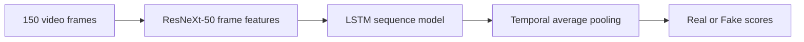

# Deepfake Video Detection with ResNeXt-50 and LSTM

A research prototype for classifying face-cropped video clips as **Real** or **Fake**. The project combines frame-level visual features from ResNeXt-50 with temporal modeling from an LSTM, and includes a Streamlit interface for exploring the method, results, and video inference workflow.

> This is an experimental classifier. Its predictions are not forensic proof and should not be used as the sole basis for decisions about a video.

## Project overview

The notebook contains the data preparation, training, and validation workflow. The Streamlit app loads the trained checkpoint, analyzes a video, and displays the prediction scores and sampled frames.



### Main components

- **Feature extractor:** ImageNet-pretrained ResNeXt-50, fine-tuned to produce a 2,048-dimensional feature vector for each frame.
- **Temporal model:** A one-layer LSTM with a hidden size of 2,048 processes the ordered frame features.
- **Classifier:** Adaptive average pooling, dropout, LeakyReLU, and a two-class linear layer produce Real and Fake scores.
- **Interface:** Streamlit pages describe the project, methodology, validation results, and video-analysis workflow.

## Dataset and preprocessing

The notebook uses the [DeepFake Detection Cropped Dataset on Kaggle](https://www.kaggle.com/datasets/ucimachinelearning/deep-fake-detection-cropped-dataset), derived from DFDC. The downloaded dataset contained 1,727 Real and 1,566 Fake clips. For this experiment, the notebook randomly selected 600 clips from each class, then made a stratified 80/20 split:

| Split | Real | Fake | Total |
|---|---:|---:|---:|
| Training | 480 | 480 | 960 |
| Validation | 120 | 120 | 240 |
| **Selected subset** | **600** | **600** | **1,200** |

For each video, OpenCV reads up to 150 consecutive frames from the beginning. Frames are resized to 112 × 112 pixels and converted from BGR to RGB. If a clip has fewer than 150 readable frames, its last frame is repeated to fill the sequence. The dataset supplies cropped faces; the application does not perform face detection or face cropping on arbitrary footage.

## Training

The notebook trains the model in PyTorch for 10 epochs using cross-entropy loss and Adam, with a learning rate of `1e-5` and weight decay of `1e-3`. It saves the checkpoint with the highest validation accuracy. Training was performed in Google Colab with a Tesla T4 GPU.

The notebook downloads the Kaggle dataset and asks for Kaggle API credentials. It also installs the Kaggle CLI in a notebook cell.

## Validation results

The best checkpoint achieved the following results on the 240-video validation split:

| Metric | Score |
|---|---:|
| Accuracy | 83.33% |
| ROC AUC | 90.34% |
| Fake precision | 82.26% |
| Fake recall | 85.00% |
| Fake F1-score | 83.61% |

Confusion matrix counts, with rows representing actual labels and columns representing predictions:

| Actual | Predicted Real | Predicted Fake |
|---|---:|---:|
| Real | 101 | 19 |
| Fake | 17 | 103 |

These results describe one stratified split of a balanced subset from a single dataset source. They do not establish performance on other datasets, manipulation methods, or in-the-wild videos. The validation split was used both to select the checkpoint and report these metrics.

## Run the Streamlit app

### Requirements

- Python 3.11
- The model checkpoint described below

Create an environment and install the project dependencies:

```bash
git clone https://github.com/Vinay04yadav/Deepfake_Detection.git
cd Deepfake_Detection
python3.11 -m venv .venv
source .venv/bin/activate
python -m pip install -r requirements.txt
```

On Windows, activate the environment with:

```powershell
.venv\Scripts\activate
```

Place `deepfake_detector_best.pth` in the project root, beside `app.py`, then start the app:

```bash
python -m streamlit run app.py
```

The app opens on `http://localhost:8501`. Use the navigation bar to read the project pages or open **Try yourself** to upload an MP4, AVI, MOV, or MKV clip. Inference analyzes the first 150 decoded frames. The app shows the Real and Fake softmax scores and four frames sampled from that sequence. Softmax scores are not calibrated probabilities.

## Model checkpoint status

The 216 MB checkpoint is not included in this GitHub repository. The repository ignores `*.pth` files, so cloning the code alone is not enough to run inference. The current app expects `deepfake_detector_best.pth` in the project root. A public checkpoint download location has not been published yet; Hugging Face hosting is still in progress.

## Development notebook

Open [`Deepfake_Detection_Development.ipynb`](Deepfake_Detection_Development.ipynb) in Jupyter or Google Colab. The notebook includes preprocessing, model definition, training, validation metrics, and plots. Running the full notebook requires Kaggle API access and the dataset download.

## Research paper

This project is described in the paper [“Deepfake Video Detection Using a Combined CNN-LSTM Approach”](https://doi.org/10.1109/ICSIT65336.2025.11294356), published in the 2025 International Conference on Sustainability, Innovation and Technology.

## Repository contents

```text
app.py                              Streamlit interface and inference code
Deepfake_Detection_Development.ipynb Training and evaluation notebook
requirements.txt                    App and notebook dependencies
.streamlit/config.toml              Streamlit theme and upload settings
test_videos/                        Small sample clips used during development
```

The checkpoint is distributed separately from the source repository.

## License

The source project is licensed under [CC BY-NC-SA 4.0](LICENSE.txt). The dataset has its own terms; review those terms before downloading or redistributing dataset content.
